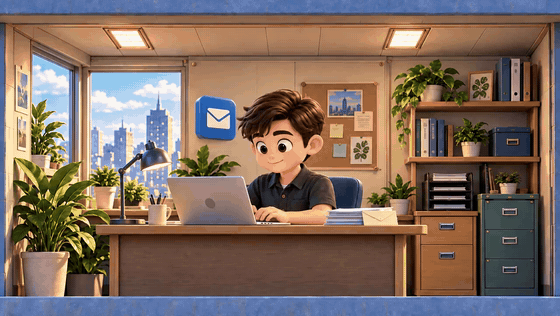
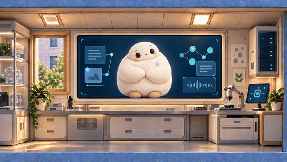

# 伴境 Companest

## 你的 AI 工作小世界。

**让工作，有伙伴。**

[English](README.md) · [返回个人首页](https://github.com/Owen-Teng/Owen-Teng/blob/main/README.zh-CN.md) · [创意由来](docs/ORIGIN.zh-CN.md) · [邮件功能](docs/MAIL-FEATURES.zh-CN.md)

## 30 秒实机操作：从进入到保存回复

[播放高清实录](docs/media/companest-real-mail-30s-redacted.mp4)

从小世界走进邮件房间，点开一件真实事项，看背景与建议，把回复改成自己的意思，再保存到本机。

这段 30 秒视频保留了实际鼠标点击、角色动画、界面切换和保存反馈；人名、公司名称及收发件邮箱已打码。

*实机操作剪辑，压缩了操作间隔；建议已在准备阶段生成，片中打开已有建议，不代表首次生成速度。本次只保存本地草稿，没有发送邮件。中文界面仍有 Friday 标识。*

## 为什么做这个产品？

伴境从 HR AI 的探索出发，在我与 AI 的持续讨论、设计和反馈中，逐步明确为更广泛的工作场景 Agent OS。我关注的是：怎样让人容易开始，怎样把同一件事的背景与后续变化看清楚，以及怎样在 AI 协作中保留人的决定权。

房间组织工作入口，动画让空间更亲切，事项黑板呈现眼前需要关注的事。建议可以核对，回复可以修改，重要操作由本人决定。HR、项目协作与客户沟通都是可能的应用场景。

**我的参与：产品方向、交互体验、前端探索与发布表达；与 Robinson AI Lab 伙伴共同建设。**

## 六位伙伴，能力逐版解锁

邮件助理是首个可体验流程。所有助理已有场景动画，其他业务能力仍按开发和验收进展逐步开放。

### 邮件助理 · 首发可用

查看邮件要点与往来背景，编辑回复，并继续跟进同一件事。

当前邮件预览已提供内置样例和 163 邮箱接入；AI 建议需要自己的受支持环境。

### 微信助理 · 实验开发中 · 待解锁

规划从相关会话中找出需要处理的信息，整理上下文和后续行动。

已有实验模块和动画，尚未形成完整桌面业务流程。

### 飞书助理 · 功能待解锁

规划连接工作消息与协作事项，将需要你处理的请求集中呈现。

当前已有场景和动画，飞书业务尚未完整接通；不宣称消息、审批、日历已全部可用。

### 知识库助理 · 功能待解锁

规划在你选定的资料中检索、整理，并保留可以回到原文的出处。

当前展示动画与入口，通用知识工作流程尚未完整接通。

### 文件助理 · 功能待解锁

规划帮助定位你选定范围内的文件，理解文件内容和版本线索。

当前展示动画与入口，文件业务尚未接入；不承诺自动整理或删除原件。

### 答疑助理 · 功能待解锁

规划结合已接入的资料与当前事项回答问题，显示依据并说明不确定之处。

当前展示动画与入口，通用答疑业务尚未接入。

## 邮件助理：从一封来信，到接着把事办好

[观看 30 秒真实操作与反馈](docs/media/companest-real-mail-30s-redacted.mp4)

从小世界走进邮件房间，点开一件真实事项，看背景与建议，把回复改成自己的意思，再保存到本机。

这段 30 秒视频保留了实际鼠标点击、角色动画、界面切换和保存反馈；人名、公司名称及收发件邮箱已打码。

*实机操作剪辑，压缩了操作间隔；建议已在准备阶段生成，片中打开已有建议，不代表首次生成速度。本次只保存本地草稿，没有发送邮件。中文界面仍有 Friday 标识。*

[查看已实现能力、五步界面与使用条件](docs/MAIL-FEATURES.zh-CN.md)

## 当前阶段与获取方式

Windows 邮件助理预览，应用版本 0.3.26。已有邮件事项、草稿和跟进流程；163 邮箱和 AI 建议需要使用者自己的受支持环境。新实录使用本机现有真实邮件事项与已生成建议，完成本地草稿保存；没有发送邮件或量化效率提升结论。

**产品介绍与演示已公开；源码和安装包尚未对公众开放。** [体验、源码与数据边界](docs/ACCESS.md)

更早的公开实践可见 [FridayOS 1.0](https://github.com/Robinson-AI-Lab/FridayOS1.0)。该历史仓库与当前伴境邮件预览分别描述，不代表新功能已在旧仓库交付。

## 关注进展与反馈

可以 Star 收藏或 Watch 关注更新。[反馈一个具体工作场景或预览问题](https://github.com/Owen-Teng/companest/issues/new?template=feedback.yml)。请使用虚构例子，不要发布邮箱凭据、真实邮件或私人信息。

本仓库独立承接产品展示与反馈；访问量和 Star 不代表安装人数或活跃用户。
