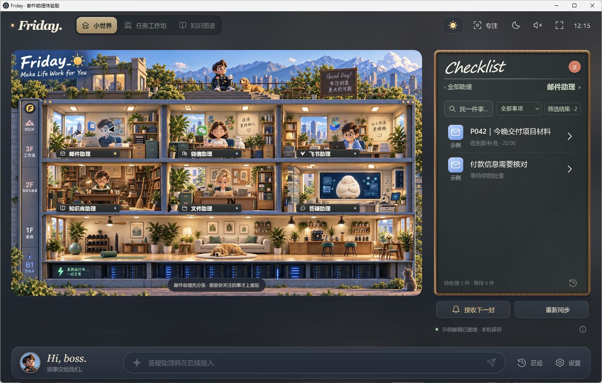
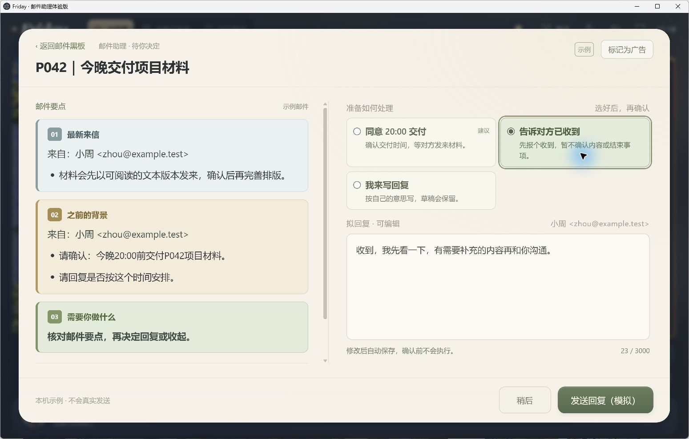
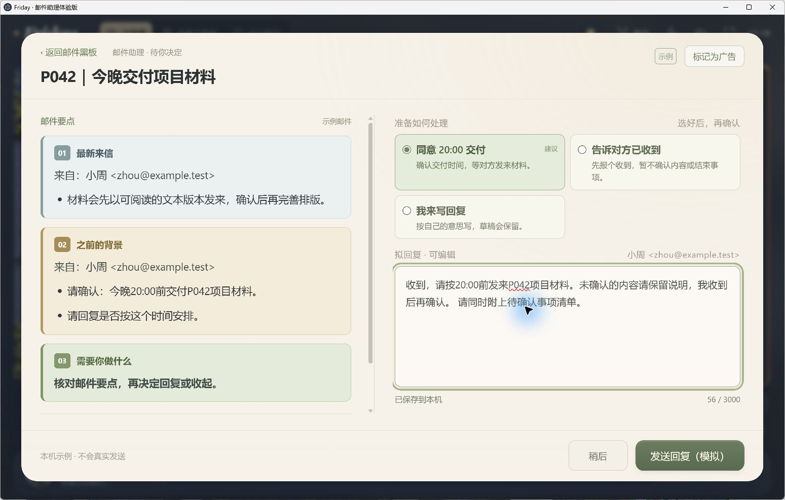
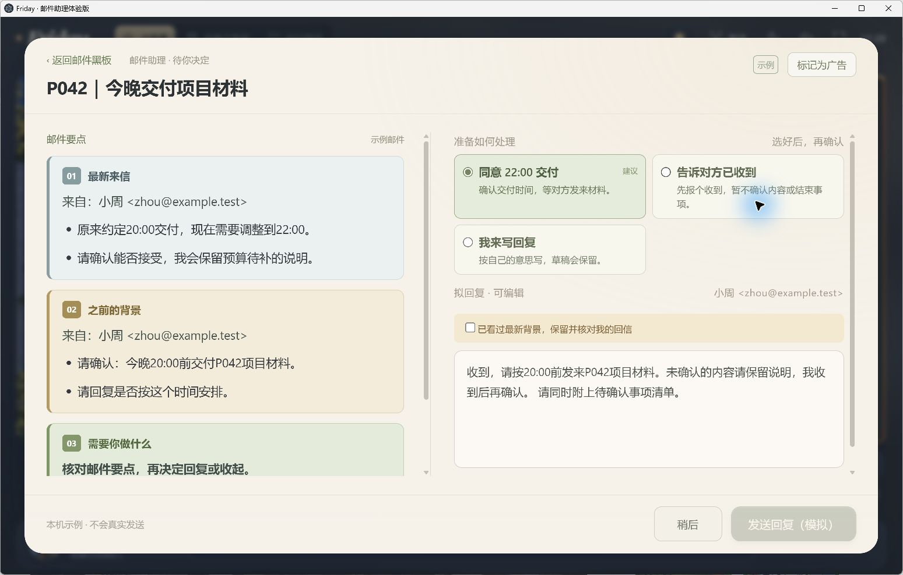

# 邮件助理：已经实现什么，怎样使用

伴境的第一个可体验流程，是把持续往来的邮件作为一件事来处理：先看清背景，再准备回复，并在事情变化后继续跟进。

## 用一个项目样例，看完整过程

### 01 · 从小世界找到待处理事项

进入邮件房间，黑板列出需要关注的事项。示例 P042 是“今晚交付项目材料”。

### 02 · 阅读最新来信和之前的背景

打开事项，左侧展示最新信息、之前约定与需要你做什么，右侧准备处理和回复。先理解这次要决定的内容。

### 03 · 按自己的意思修改回复

选择处理方式或自行写回复。样例里，在草稿后补上“请同时附上待确认事项清单”。修改保存在本机。

### 04 · 本人操作后，继续跟进

样例模式只模拟回复效果，不会真的发送邮件。处理后可以继续看到同一事项的等待状态和后续记录。

### 05 · 新情况出现，核对旧草稿

对方把交付时间从 20:00 调整到 22:00，新来信仍关联原事项。之前写好的草稿保留，界面提醒阅读最新背景并重新核对，避免沿用已经过时的回复。

[观看完整分镜 GIF](media/mail-scenes.gif) · [高清分镜 MP4](media/mail-scenes.mp4)

**画面说明：** 上述图片是更名前版本的真实应用截图，使用独立虚构 P042 数据，因此可见 Friday 标识。短片是这些截图的分镜编排，含阅读停留和转场，不是连续录屏。助理场景动画是实际应用素材，不是业务执行记录。

## 已实现能力与使用条件

| 功能 | 用户能做什么 | 当前依据和边界 |
|---|---|---|
| 无账号样例体验 | 浏览虚构邮件、处理事项、编辑草稿、模拟回复与新补充 | 已有本地界面操作回执；不连接真实账号 |
| 事项黑板与邮件查看 | 找到待处理事项，查看邮件、背景与后续状态 | 已有实现与样例演示 |
| 草稿编辑与保存 | 选择处理方式或自行写回复，在本机保留修改 | 已有实现、样例操作与自动检查 |
| 同一事项持续跟进 | 后续来信关联已有事项，新旧背景一起核对 | 已有实现与合成样例验证；仅同标题不能保证归为同一事项 |
| 新补充后的草稿核对 | 保留已写内容，提示结合最新背景重新审阅 | 已有样例实测，见上方 20:00 → 22:00 示例 |
| 163 邮箱连接与同步 | 在连接设置使用自己的邮箱及客户端授权码 | 当前实现支持；本轮不重新连接真实邮箱验收 |
| 多账号与来源区分 | 保留各账号的同步进度，回复使用事项所属账号 | 已有实现与本地自动检查；不代表支持任意服务商 |
| 本人确认后的真实发送 | 核对对象与内容，再明确发送，并保存结果状态 | 当前 SMTP 实现及本地协议测试；服务器接受不等于对方收到 |
| 邮件过滤纠正 | 对分拣结果进行纠正，标记或恢复广告邮件 | 已有实现与自动检查；不承诺自动判断全部准确 |
| 往来记忆与 AI 回信建议 | 在支持的环境中结合相关往来，查看建议、引用与不确定信息 | 需要本机 Codex CLI、本人登录和额度；本页没有调用真实模型演示 |
| 本地数据与凭据保护 | 邮件、草稿和工作状态留在本机，授权码通过本机机制保护 | 代码实现；请求 AI 时，选定上下文仍会发往所配置服务 |

这里的“已实现”指当前版本存在相应代码；样例演示、自动测试、真实邮箱接通和真实业务结果分别说明。没有把程序测试写成用户业务验收。

## 当前不能据此承诺的能力

- 任意邮箱服务商即连即用；当前通用连接入口是 163，公司适配器需要特定环境和独立证书条件。
- AI 自动代替本人确认并发送全部邮件。
- 所有邮箱、所有历史邮件、所有附件都已被完整理解。
- 微信、飞书、知识库、文件和答疑助理已经完成桌面业务接通。
- 通用模型供应商选择、手机端、团队共享或自动更新已经交付。

## 从哪里开始

先按[当前体验与源码说明](ACCESS.md)运行独立样例，再按需连接自己的受支持邮箱。真实发送与 AI 调用只在理解当前设置和范围后使用。

[源码获取说明](ACCESS.md) · [数据边界](ACCESS.md) · [产品创意由来](ORIGIN.zh-CN.md)
