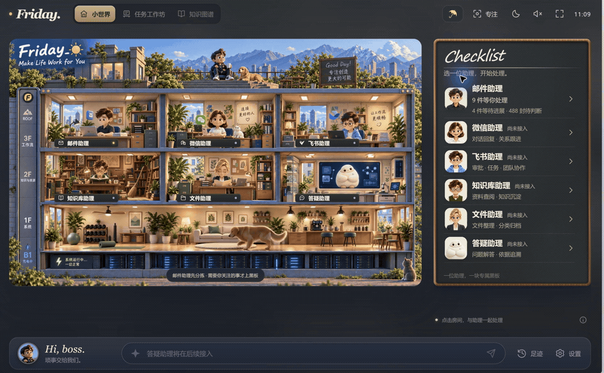

# Companest: a little world you can work in

What if opening your inbox felt like walking into a little room? I am building Companest with Robinson AI Lab, exploring animated companions, rooms and a matter board as approachable entry points to work with AI.

## 30 seconds of real interaction: enter, edit, save

[Watch the HD recording](media/companest-real-mail-30s-redacted.mp4)

Enter the mail room from the little world, open a real matter, review its context and suggestions, edit the reply, and save the draft locally.

This 30-second recording keeps the real mouse clicks, character animation, interface transitions and save feedback. Names, company references and sender/recipient addresses are mosaicked.

*Edited real desktop footage with gaps shortened. Suggestions were generated during preparation; the clip reopens them and does not demonstrate first-generation speed. The draft was saved locally; no email was sent. The Chinese interface still shows Friday branding.*

Six companions have scene animations. Mail is the first usable preview; the other five complete workflows unlock progressively. Source and installers are not public yet.

Would a room like this make you more willing to check your work, or would you prefer a plain list?

[Companest](https://github.com/Owen-Teng/companest) · Writing assisted by Codex.
